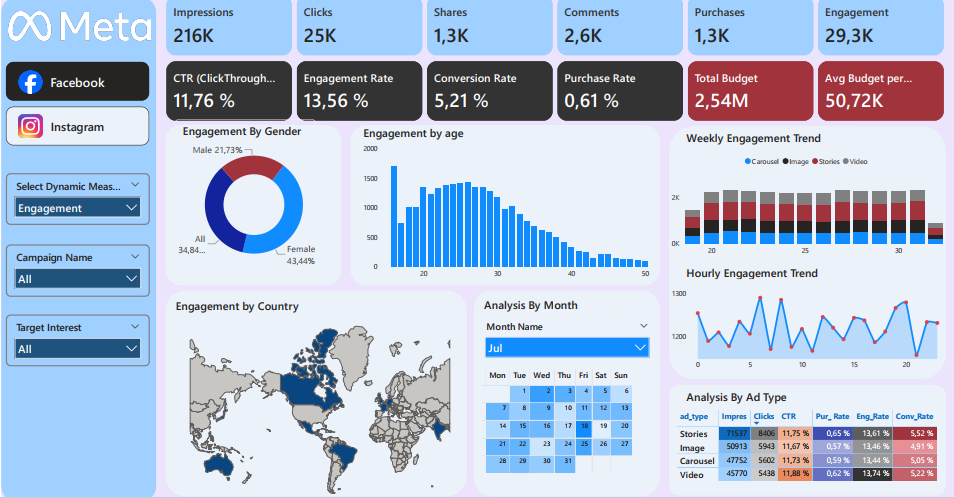

# Meta Ad Performance Dashboard — Power BI

### Impressions, clicks, engagement, conversions and budget analysis across campaigns, ad types, platforms, demographics and geographies

**Author:** Brice Abogo
**Specialization:** Financial Analysis | Accounting | Business Intelligence
**Technologies:** Power Query | DAX | SQL | Power BI Desktop | Power BI Service | On-premises Data Gateway

---

## 1. Project Overview

This project delivers an end-to-end Business Intelligence solution for analyzing Meta (Facebook & Instagram) advertising performance. Four CSV files (ad events, ads, campaigns and users) are transformed with Power Query, organized in a star schema, and exploited through DAX measures in a two-page interactive Power BI report — one page per platform.

The dashboard enables users to:

- monitor impressions, clicks, shares, comments, purchases and overall engagement;
- evaluate key performance rates: CTR, engagement rate, conversion rate and purchase rate;
- track total and average campaign budgets;
- break down every metric by gender, age, country, ad type, campaign and target interest;
- analyze trends by week number, hour of day and calendar month;
- compare Facebook and Instagram performance on dedicated pages;
- dynamically switch the displayed measure using a field parameter slicer.

The project also demonstrates publication to Power BI Service with an on-premises standard gateway and scheduled refresh.

---

## 2. Business Questions

1. How do impressions, clicks and engagement compare between Facebook and Instagram?
2. Which ad types (Carousel, Image, Stories, Video) deliver the highest CTR and conversion rate on each platform?
3. How does engagement vary by user gender, age and country?
4. What are the weekly and hourly engagement trends?
5. Which campaigns consume the most budget relative to their performance?
6. How does the purchase rate compare across ad types and platforms?

---

## 3. Tools and Technologies

| Technology | Usage |
|---|---|
| Power Query (M) | Import, cleaning and typing of CSV files |
| Power BI Desktop | Data model and interactive report |
| DAX | Measures, calculated table (Calendar), field parameter for dynamic measure selection |
| SQL (MS SQL Server) | Equivalent analytical queries for portfolio demonstration |
| Power BI Service | Report publication |
| On-premises Data Gateway (standard mode) | Access to local CSV files and scheduled refresh |
| GitHub | Documentation and portfolio |

---

## 4. Data

| File | Content | Columns |
|---|---|---:|
| `data/ad_events.csv` | Ad interaction events (impressions, clicks, shares, comments, purchases) | 7 |
| `data/ads.csv` | Ad reference with targeting attributes | 7 |
| `data/campaigns.csv` | Campaign reference with dates and budgets | 6 |
| `data/users.csv` | User demographics | 7 |

- **Period:** data spans the dates present in the ad events file (June–July range observed).
- **Volume:** approximately 216 000 impression events across all event types.
- **Source:** publicly available dataset found online; exact origin unknown. Original license unconfirmed.
- **Usage:** educational and demonstrative. The data is most likely synthetic.

> The MIT license applies to the code and documentation, **not to the data files**. Details in [`data/README.md`](data/README.md).

---

## 5. Data Preparation

The Power Query scripts, fully commented and documented, are in [`power-query/`](power-query/).

| Table | Transformations |
|---|---|
| `ad_events` | CSV import via parameterized path, header promotion, column typing (Int64, datetime, text), Date column extracted from timestamp, Event Hour extracted from timestamp |
| `ads` | CSV import, header promotion, column typing |
| `campaigns` | CSV import, header promotion, decimal separator replacement 
