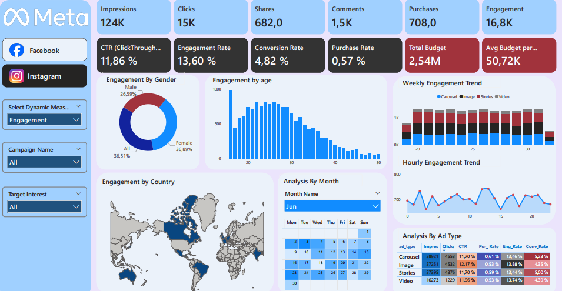

# Meta Ad Performance Dashboard — Power BI

### Impressions, clicks, engagement, conversions and budget analysis across campaigns, ad types, platforms, demographics and geographies

**Author:** Brice Abogo
**Specialization:** Financial Analysis | Accounting | Business Intelligence
**Technologies:** Power Query | DAX | SQL | Power BI Desktop | Power BI Service | On-premises Data Gateway


---

## 1. Project Overview

This project delivers an end-to-end Business Intelligence solution for analyzing Meta (Facebook & Instagram) advertising performance. Four CSV files (ad events, ads, campaigns and users) are transformed with Power Query, organized in a star schema, and exploited through DAX measures in a single-page interactive Power BI report.

The dashboard enables users to:

- monitor impressions, clicks, shares, comments, purchases and overall engagement;
- evaluate key performance rates: CTR, engagement rate, conversion rate and purchase rate;
- track total and average campaign budgets;
- break down every metric by gender, age, country, ad platform, ad type, campaign and target interest;
- analyze trends by week number, hour of day and calendar month;
- dynamically switch the displayed measure using a field parameter slicer.

The project also demonstrates publication to Power BI Service with an on-premises standard gateway and scheduled refresh.

---

## 2. Business Questions

1. How do impressions, clicks and engagement distribute across Facebook and Instagram?
2. Which ad types (Carousel, Image, Stories, Video) deliver the highest CTR and conversion rate?
3. How does engagement vary by user gender, age and country?
4. What are the weekly and hourly engagement trends?
5. Which campaigns consume the most budget relative to their performance?
6. How does the purchase rate compare across ad types and platforms?

---

## 3. Tools and Technologies

| Technology | Usage |
|---|---|
| Power Query (M) | Import, cleaning and typing of CSV files |
| Power BI Desktop | Data model and interactive report |
| DAX | Measures, calculated table (Calendar), field parameter for dynamic measure selection |
| SQL (MS SQL Server) | Equivalent analytical queries for portfolio demonstration |
| Power BI Service | Report publication |
| On-premises Data Gateway (standard mode) | Access to local CSV files and scheduled refresh |
| GitHub | Documentation and portfolio |

---

## 4. Data

| File | Content | Columns |
|---|---|---:|
| `data/ad_events.csv` | Ad interaction events (impressions, clicks, shares, comments, purchases) | 7 |
| `data/ads.csv` | Ad reference with targeting attributes | 7 |
| `data/campaigns.csv` | Campaign reference with dates and budgets | 6 |
| `data/users.csv` | User demographics | 7 |

- **Period:** data spans the dates present in the ad events file (June–July range observed).
- **Volume:** approximately 216 000 impression events across all event types.
- **Source:** publicly available dataset found online; exact origin unknown. Original license unconfirmed.
- **Usage:** educational and demonstrative. The data is most likely synthetic.

> The MIT license applies to the code and documentation, **not to the data files**. Details in [`data/README.md`](data/README.md).

---

## 5. Data Preparation

The Power Query scripts, fully commented and documented, are in [`power-query/`](power-query/).

| Table | Transformations |
|---|---|
| `ad_events` | CSV import via parameterized path, header promotion, column typing (Int64, datetime, text), Date column extracted from timestamp |
| `ads` | CSV import, header promotion, column typing |
| `campaigns` | CSV import, header promotion, decimal separator replacement (`.` → `,`), column typing including currency as number |
| `users` | CSV import, header promotion, column typing |

All scripts use a `Path` parameter so file locations can be changed in one place.

---

## 6. Data Model

Star schema: one fact table (`ad_events`), three dimension tables (`ads`, `users`, `Calendar`) and one campaign reference table. The `Select Dynamic Measure` table is a standalone field parameter.


| Relationship | Keys |
|---|---|
| `campaigns` → `ads` | `campaign_id` → `campaign_id` |
| `ads` → `ad_events` | `ad_id` → `ad_id` |
| `users` → `ad_events` | `user_id` → `user_id` |
| `Calendar` → `ad_events` | `Date` → `Date` |

Details in [`documentation/data-model.md`](documentation/data-model.md).

---

## 7. DAX Measures

| Family | Measures |
|---|---|
| Event counts | Impressions, Clicks, Shares, Comments, Purchases, Likes |
| Composite metric | Engagement (= Clicks + Shares + Comments) |
| Rates | CTR (ClickThrough Rate), Engagement Rate, Conversion Rate, Purchase Rate |
| Budget | Total Budget, Avg Budget per Campaign |
| Dynamic display | Select Dynamic Measure (field parameter), Dynamic Title |
| Calendar columns | Month Name, Year Month_num, Day Name, Month Day_num, Week Day_num, Year Week_num |

Design notes:

- rates use `DIVIDE` to safely handle zero denominators;
- the `Calendar` table is generated with `CALENDAR(MIN, MAX)` from the fact table dates;
- the field parameter allows the user to switch among six measures in a single visual.

Full documentation in [`dax/`](dax/).

---

## 8. SQL Equivalents

Equivalent MS SQL Server queries that reproduce the DAX logic are provided in [`sql/`](sql/). These queries demonstrate the same analytical calculations using standard SQL, suitable for environments where Power BI is not available.

---

## 9. Report Pages

### Page 1 — Full Dashboard (All Platforms or Facebook)

Twelve KPI cards, engagement breakdown by gender and age, world map by country, calendar matrix by month, weekly engagement trend by ad type, hourly engagement trend and performance table by ad type.


### Page 2 — Instagram View

Same layout filtered on Instagram, showing platform-specific performance differences.



**Slicers:** Platform (Facebook / Instagram buttons), Select Dynamic Measure, Campaign Name, Target Interest, Month Name.

---

## 10. Key Figures

### All Platforms Combined

| Indicator | Value |
|---|---:|
| Impressions | 216K |
| Clicks | 25K |
| Shares | 1.3K |
| Comments | 2.6K |
| Purchases | 1.3K |
| Engagement | 29.3K |
| CTR (ClickThrough Rate) | 11.76% |
| Engagement Rate | 13.56% |
| Conversion Rate | 5.21% |
| Purchase Rate | 0.61% |
| Total Budget | 2.54M |
| Avg Budget per Campaign | 50.72K |

### Instagram Only

| Indicator | Value |
|---|---:|
| Impressions | 124K |
| Clicks | 15K |
| Shares | 682 |
| Comments | 1.5K |
| Purchases | 708 |
| Engagement | 16.8K |
| CTR | 11.86% |
| Engagement Rate | 13.60% |
| Conversion Rate | 4.82% |
| Purchase Rate | 0.57% |

---

## 11. Findings

1. **Stories lead in volume.** Stories generate the most impressions (71.5K) and clicks (8.4K) across all platforms, with a CTR of 11.75% and an engagement rate of 13.61%.
2. **Video delivers the highest CTR.** Despite the lowest impression count (45.8K), Video achieves a CTR of 11.88% and the highest engagement rate at 13.74%.
3. **Conversion rate is highest for Stories.** Stories convert at 5.52%, followed by Video at 5.22%, Carousel at 5.05% and Image at 4.91%.
4. **Female users drive engagement.** Women account for 43.44% of engagement, followed by the "All" (non-specified) category at 34.84% and males at 21.73%.
5. **Engagement peaks in the 25–35 age range.** The age distribution shows a clear concentration of engagement among users aged 25 to 35.
6. **Instagram shows a more balanced gender split.** On Instagram, female engagement is 36.89%, "All" is 36.51% and male is 26.59%.
7. **Hourly trend is relatively flat.** Engagement fluctuates modestly across hours, with no extreme peak, suggesting broad time-zone coverage in the audience.
8. **Purchase rate remains low.** At 0.61% overall, the purchase rate suggests the funnel narrows significantly after the click stage.

### Areas for Further Analysis

- Drill into conversion rate by campaign to identify top and bottom performers.
- Cross-analyze ad type and platform to find optimal combinations.
- Investigate the "All" gender category to determine if it represents missing data or a targeting choice.

---

## 12. Technical Architecture

```text
CSV files (local)
        |
        v
Power Query (import, cleaning, typing)
        |
        v
Star schema (ad_events fact, ads, users, campaigns, Calendar)
        |
        v
DAX measures (counts, rates, field parameter, calendar columns)
        |
        v
Power BI Desktop report (single interactive page)
        |
        v
Power BI Service
        |
        v
On-premises Data Gateway (standard mode)
        |
        v
Scheduled refresh: 11:30 AM and 5:00 PM (South Africa time, UTC+2)
