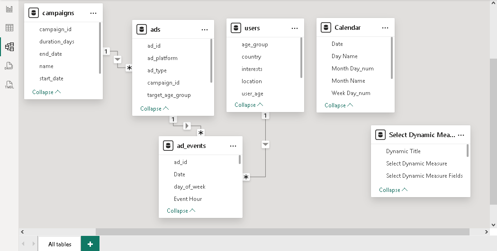

# Data Model

## Schema Type

Star schema with one fact table and three dimension tables, plus a calculated Calendar table and a field parameter table.

## Tables

### Fact Table

| Table | Description | Grain |
|---|---|---|
| `ad_events` | Ad interaction events | One row per event (impression, click, share, comment, purchase, like) |

### Dimension Tables

| Table | Description | Grain |
|---|---|---|
| `ads` | Ad reference with platform, type and targeting | One row per ad |
| `users` | User demographics (gender, age, country, interests) | One row per user |
| `campaigns` | Campaign reference (name, dates, budget) | One row per campaign |
| `Calendar` | Date dimension (DAX calculated table) | One row per calendar date |

### Utility Table

| Table | Description |
|---|---|
| `Select Dynamic Measure` | Field parameter enabling dynamic measure switching in visuals |

## Relationships

| From Table | From Column | → | To Table | To Column | Cardinality | Cross-filter |
|---|---|---|---|---|---|---|
| `campaigns` | `campaign_id` | → | `ads` | `campaign_id` | 1:N | Single |
| `ads` | `ad_id` | → | `ad_events` | `ad_id` | 1:N | Single |
| `users` | `user_id` | → | `ad_events` | `user_id` | 1:N | Single |
| `Calendar` | `Date` | → | `ad_events` | `Date` | 1:N | Single |

## Diagram

## Column Details

### ad_events (Fact)

| Column | Type | Description |
|---|---|---|
| `event_id` | Int64 | Unique event identifier |
| `ad_id` | Int64 | Foreign key to `ads` |
| `user_id` | Text | Foreign key to `users` |
| `timestamp` | DateTime | Event date and time |
| `day_of_week` | Text | Day name from source |
| `time_of_day` | Text | Time period label from source |
| `event_type` | Text | Event category: Impression, Click, Share, Comment, Purchase, Like |
| `Date` | Date | Extracted from timestamp (computed in Power Query) |
| `Event Hour` | Int64 | Hour component extracted from timestamp (computed in Power Query) |

### ads (Dimension)

| Column | Type | Description |
|---|---|---|
| `ad_id` | Int64 | Primary key |
| `campaign_id` | Int64 | Foreign key to `campaigns` |
| `ad_platform` | Text | Platform: Facebook or Instagram |
| `ad_type` | Text | Creative type: Carousel, Image, Stories, Video |
| `target_gender` | Text | Targeting: Male, Female, All |
| `target_age_group` | Text | Targeting age group |
| `target_interests` | Text | Targeting interests |

### campaigns (Dimension)

| Column | Type | Description |
|---|---|---|
| `campaign_id` | Int64 | Primary key |
| `name` | Text | Campaign name |
| `start_date` | Date | Campaign start date |
| `end_date` | Date | Campaign end date |
| `duration_days` | Int64 | Campaign duration in days |
| `total_budget` | Number | Total campaign budget |

### users (Dimension)

| Column | Type | Description |
|---|---|---|
| `user_id` | Text | Primary key |
| `user_gender` | Text | Gender: Male, Female, All |
| `user_age` | Int64 | User age |
| `age_group` | Text | Age group label |
| `country` | Text | Country of the user |
| `location` | Text | Location (city or region) |
| `interests` | Text | User interests |

### Calendar (Calculated)

| Column | Type | Description |
|---|---|---|
| `Date` | Date | Calendar date (primary key) |
| `Month Name` | Text | Abbreviated month name (e.g., "Jul") |
| `Year Month_num` | Int64 | Month number (1–12), used for sorting |
| `Day Name` | Text | Abbreviated day name (e.g., "Mon") |
| `Month Day_num` | Int64 | Day of month (1–31) |
| `Week Day_num` | Int64 | Day of week (1 = Monday, 7 = Sunday) |
| `Year Week_num` | Int64 | Week number of the year |

### Select Dynamic Measure (Field Parameter)

| Column | Type | Description |
|---|---|---|
| `Select Dynamic Measure` | Text | Display label shown in the slicer |
| `Select Dynamic Measure Fields` | Text | NAMEOF reference to the DAX measure |
| `Select Dynamic Measure Order` | Int64 | Sort order (0–5) |
